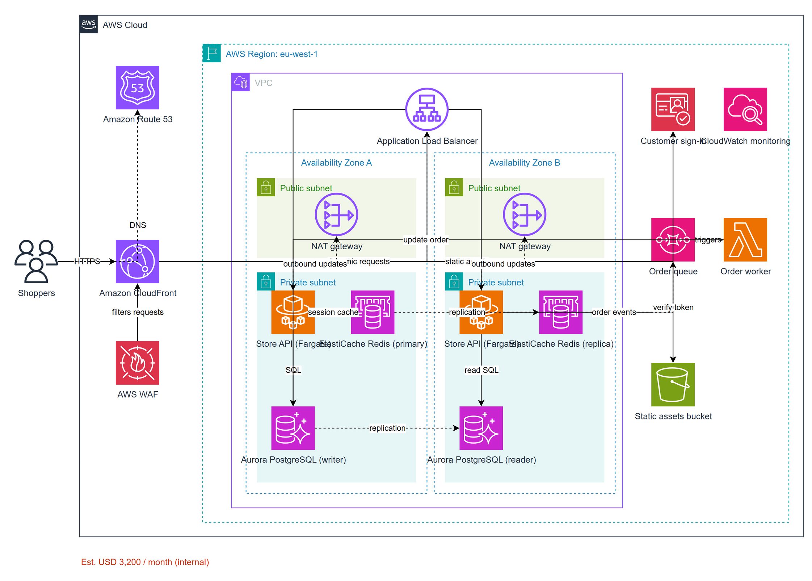
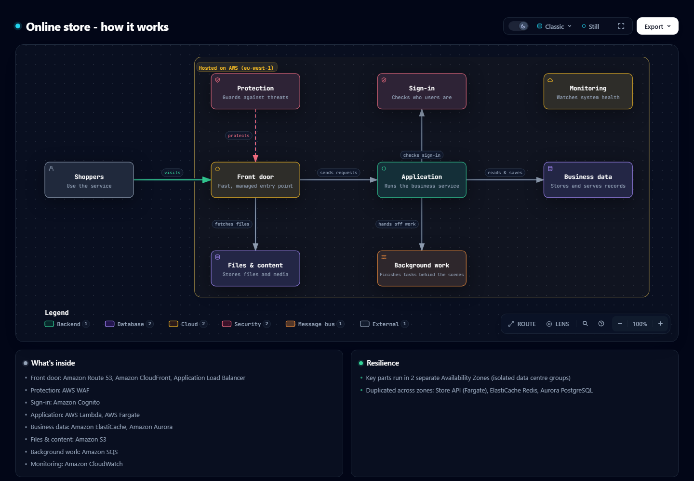
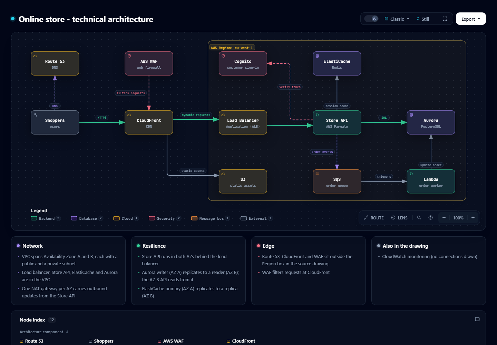

# drawio-to-archify

Turn a technical draw.io AWS architecture into interactive, presentable diagrams for every audience.

- **Executive view**: plain-language blocks such as "Front door", "Application" and "Business data", with animated flows and a card that names the AWS services behind each block.
- **Technical view**: the real AWS components, with repeated per-AZ resources folded into one node and network detail in cards.

Both views are standalone HTML files made with [Archify](https://github.com/tt-a1i/archify), with dark/light themes, live traffic animation and PNG/SVG/WebM export. The draw.io file stays your source of truth and is never changed.

## Before and after

**Before: the technical draw.io diagram** (`examples/online-store/online-store.drawio`)



The red "internal" price note is planted on purpose. The parser flags it and keeps it out of both views.

**After: executive view** for business owners and management



**After: technical view** for architects and engineers



The screenshots are still images. Open the HTML files in `examples/online-store/` in a browser to see the animated traffic flow, hover cards and dark/light themes.

## Why

A draw.io architecture with 150 shapes works for engineers and loses everyone else. Rather than redrawing it, this kit reads it and produces a view for each audience, using only what the drawing actually contains.

## What's in the repo

| Path | What it is |
|---|---|
| `scripts/drawio-inventory.mjs` | Zero-dependency Node parser. It turns a `.drawio` file into an inventory of nodes, groups, edges and AWS services, suggests folds for per-AZ duplicates, flags customer-sensitive text and writes a draft executive view. |
| `glossary/aws.json` | Plain-language names and "what it does" lines for about 100 AWS4 shapes, plus the layer rules that build the executive view. Edit it to match your audience. |
| `skill/SKILL.md` | Agent skill (Kiro / Kiro Crew style) that runs the whole flow with an AI assistant. |
| `examples/online-store/` | A fictional sample: source drawing, inventory, and both views. |

## Quick start

Requirements: Node 18+, and Archify installed for the HTML step.

```bash
# 1. Inventory + draft executive view
cd examples/online-store
node ../../scripts/drawio-inventory.mjs online-store.drawio \
  --out inventory.json \
  --executive-draft executive/candidate.json \
  --title "Online store - how it works" \
  --html executive/online-store-executive.html

# 2. Render with Archify
node <archify>/bin/archify.mjs finalize architecture executive/candidate.json \
  executive/online-store-executive.html --quality showcase --json
```

The parser prints a one-line summary and any flags:

```
18 nodes, 9 groups, 18 edges; 4 fold candidates; 0 unknown services; 2 customer-safe flags
  FLAG price: text note: "Est. USD 3,200 / month (internal)"
```

The technical view is curated from `inventory.json`. See `skill/SKILL.md` step 5 and `examples/online-store/technical/candidate.json`.

## How the executive view is built

1. Each AWS shape maps to a layer in the glossary: `edge`, `security`, `identity`, `app`, `data`, `storage`, `integration`, `ops`, `backup`, `analytics`, `ai`, `people`, `onprem` or `network`.
2. One block is made per layer present. `network` (NAT gateways, VPC endpoints and so on) is left out as plumbing.
3. A link between two blocks exists only if the drawing has an edge between their members. Edges through omitted plumbing are contracted, so A → NAT → B still counts as A → B.
4. Blocks are placed on a fixed three-row grid: protection and sign-in above, the main journey in the middle, background work and storage below.
5. Cards are derived from the drawing: what's inside each block, and resilience when duplicates span more than one Availability Zone.

## Safety

- **No invention.** Nothing is added that the drawing doesn't contain: no CIDRs, ports, protocols, counts or links.
- **Customer-safe flags.** The parser flags prices, 12-digit account IDs, CIDRs/IPs, emails and "internal"/"confidential" wording, and keeps free-text notes out of the executive draft.
- **Receipts are ignored.** Archify delivery receipts contain absolute local paths, so `.gitignore` excludes them.

## Limitations

- Archify boundaries are only `region` and `security-group`. VPCs, subnets and accounts are described in cards, not drawn as boxes.
- Only AWS4 shapes are recognised by service. Other shapes are kept by label and reported as unknown.
- Archify's animation plays in a browser. In Word or PowerPoint use its PNG/SVG export.

## Credits

The interactive diagrams in this project are rendered by [Archify](https://github.com/tt-a1i/archify), created by [tt-a1i](https://github.com/tt-a1i) and released under the Apache License 2.0. This repository only prepares input for Archify, and all of the rendering, animation, theming and export comes from it. Please star and support the original project.

## License

The code and glossary in this repository are under the MIT License (see `LICENSE`). Copyright (c) 2026 Muhammad Aliff.

Archify is a separate project, licensed under Apache-2.0 by its author. It is not bundled or modified here and must be installed separately from [its repository](https://github.com/tt-a1i/archify). See `NOTICE`.
